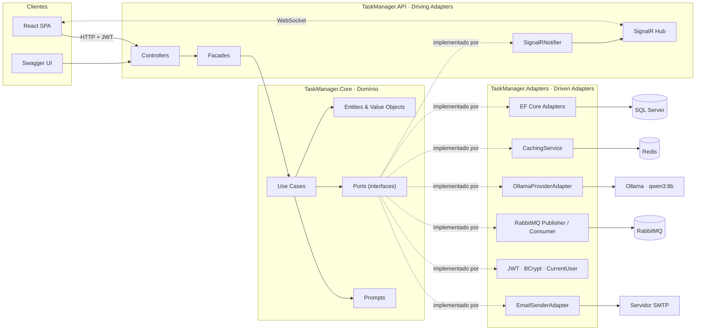
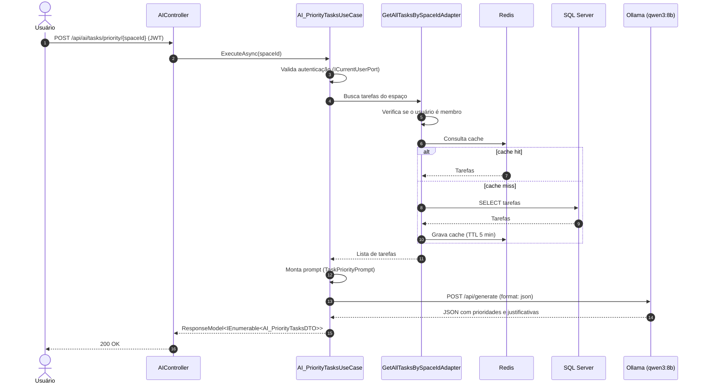
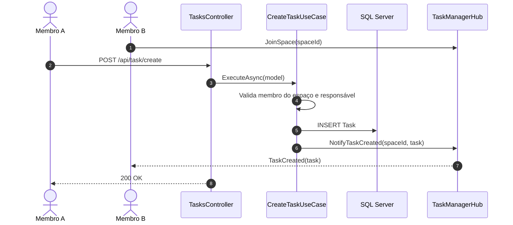
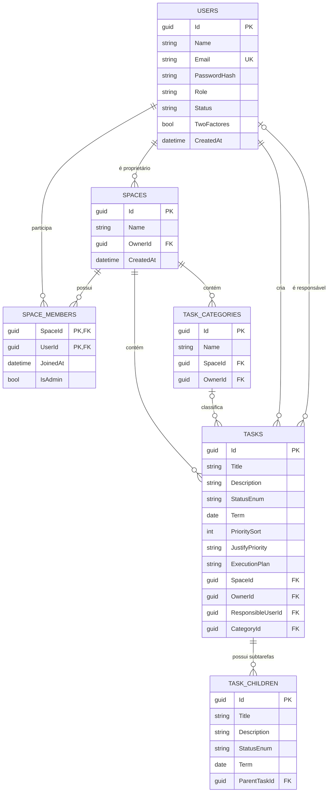

<div align="center">

# TaskManager — React · ASP.NET Core · LLM

**Gerenciador de tarefas colaborativo com espaços compartilhados, notificações em tempo real e assistência de IA executada localmente.**


</div>

---

## Sumário

- [Sobre o projeto](#-sobre-o-projeto)
- [Demonstração](#-demonstração)
- [Funcionalidades](#-funcionalidades)
- [Tecnologias](#-tecnologias)
- [Arquitetura](#-arquitetura)
- [Modelo de dados](#-modelo-de-dados)
- [Estrutura do projeto](#-estrutura-do-projeto)
- [Endpoints da API](#-endpoints-da-api)
- [Tempo real com SignalR](#-tempo-real-com-signalr)
- [Como executar](#-como-executar)
- [Configuração](#-configuração)
- [Status do projeto e roadmap](#-status-do-projeto-e-roadmap)
- [Autor](#-autor)

---

##  Sobre o projeto

O **TaskManager** é uma plataforma de gestão de tarefas orientada a **colaboração em equipe**. Usuários criam **espaços** (workspaces), convidam membros por e-mail, organizam tarefas em **categorias**, atribuem responsáveis e acompanham prazos e status — com as alterações propagadas **em tempo real** para todos os membros conectados.

O diferencial do projeto é a integração com um **LLM executado localmente via Ollama** (`qwen3:8b`), que atua como assistente de produtividade:

- prioriza as tarefas de um espaço com justificativas;
- sugere a decomposição de uma tarefa em subtarefas;
- gera um plano de execução passo a passo;
- refina título, descrição e atributos de uma tarefa.

Por rodar localmente, a IA **não depende de APIs pagas** e **não envia dados do usuário a terceiros**.

### Proposta técnica

Além do produto, o repositório demonstra a aplicação prática de:

- **Arquitetura Hexagonal (Ports & Adapters)** com um núcleo de domínio isolado de infraestrutura;
- **Use Cases** com responsabilidade única e dependências expressas por interfaces;
- **Entidades ricas** e **Value Objects** que protegem invariantes de negócio;
- **Cache distribuído** (Redis) no padrão *cache-aside* com invalidação explícita;
- **Mensageria assíncrona** (RabbitMQ) com *background consumer*;
- **Comunicação em tempo real** (SignalR) autenticada por JWT;
- **Infraestrutura containerizada** com Docker Compose.

---

##  Demonstração

> 📷 **Espaço reservado para recursos visuais.**
> Adicione aqui capturas de tela do Swagger, GIFs de uso da API ou da interface e exemplos de respostas da IA.

<!--


-->

Com a API em execução no ambiente de desenvolvimento, a documentação interativa (Swagger UI via NSwag) fica disponível em `/swagger` — a rota raiz `/` redireciona automaticamente para ela.

---

##  Funcionalidades

###  Usuários e autenticação

- Cadastro com validação de e-mail e política de senha forte.
- Login com emissão de **token JWT** (HMAC-SHA256, expiração configurável).
- Senhas armazenadas com hash **BCrypt**.
- Consulta de dados do perfil do usuário autenticado.
- Alteração de senha (exige a senha atual e uma nova senha diferente).
- Exclusão de conta via **soft delete** (o usuário é inativado, não removido).

### 🏢 Espaços colaborativos

- Criação de espaços com convite inicial de membros por e-mail.
- O criador do espaço é adicionado automaticamente como membro e proprietário.
- Adição e remoção de membros em lote por e-mail (com retorno dos e-mails não encontrados).
- Renomear e excluir espaços (restrito ao proprietário).
- Sair de um espaço (o proprietário não pode abandonar o próprio espaço).
- Listagem resumida dos espaços do usuário (dados para *sidebar*) e detalhes de um espaço.
- Listagem dos membros de um espaço.

###  Tarefas

- Criação de tarefas com título, descrição, prazo, categoria e responsável.
- Atribuição de responsável por e-mail (o responsável precisa ser membro do espaço; por padrão, é o próprio criador).
- Atualização de título, descrição, status, prazo e responsável.
- Exclusão de tarefas (restrita ao criador).
- Ciclo de status: `NotStarted` → `InProgress` / `InImpediment` → `Finished`.

### Categorias

- CRUD de categorias de tarefas, vinculadas a um espaço.
- Listagem restrita a membros do espaço; exclusão restrita ao criador da categoria.

###  Assistente de IA (Ollama)

| Recurso | Descrição |
|---|---|
| **Priorização** | Analisa todas as tarefas de um espaço e retorna a ordem sugerida com justificativa para cada uma. |
| **Subtarefas** | Decompõe uma tarefa em subtarefas com título, descrição e prazo. |
| **Plano de execução** | Gera um plano de execução textual para uma tarefa. |
| **Refinamento** | Sugere melhorias nos atributos de uma tarefa (título, descrição etc.). |

Os prompts são versionados no próprio código (`TaskManager.Core/Prompts`), escritos com critérios explícitos e instruções contra invenção de dados. O modelo é chamado com `format: "json"` e a resposta é desserializada para DTOs tipados.

###  Recursos transversais

- **Notificações em tempo real** (SignalR) para criação, atualização e exclusão de tarefas e alterações em espaços.
- **Cache Redis** em consultas frequentes (TTL de 5 minutos) com invalidação após escritas.
- **Padrão de resposta unificado** (`status`, `message`, `content`) mapeado para códigos HTTP.

---

## 🛠️ Tecnologias

### Back-end

| Tecnologia | Papel no projeto |
|---|---|
| **.NET 8 / ASP.NET Core** | API REST, injeção de dependência, autenticação e hospedagem do Hub SignalR. |
| **Entity Framework Core 8** | ORM e migrations, com mapeamento via Fluent API. |
| **SQL Server 2022** | Banco de dados relacional principal. |
| **Redis 7.4** (`StackExchangeRedis`) | Cache distribuído via `IDistributedCache`. |
| **RabbitMQ** (`RabbitMQ.Client` 7) | Mensageria assíncrona com exchange do tipo *topic*. |
| **SignalR** | Notificações em tempo real agrupadas por espaço. |
| **Ollama** + **Qwen3 8B** | LLM local para os recursos de IA, consumido via `HttpClient`. |
| **JWT Bearer** | Autenticação *stateless* da API e do Hub. |
| **BCrypt.Net-Next** | Hash de senhas. |
| **MailKit** | Envio de e-mails via SMTP. |
| **NSwag** | Geração do OpenAPI e Swagger UI com suporte a Bearer token. |
| **xUnit** + **Coverlet** | Projeto de testes unitários. |

### Front-end (em desenvolvimento)

| Tecnologia | Papel no projeto |
|---|---|
| **React 19** + **TypeScript 5.9** | Interface do usuário. |
| **Vite 7** | Build e servidor de desenvolvimento. |
| **React Router 7** | Roteamento. |
| **Zustand** | Gerenciamento de estado de autenticação. |
| **Axios** | Cliente HTTP. |

### Infraestrutura

| Tecnologia | Papel no projeto |
|---|---|
| **Docker** / **Docker Compose** | Orquestração de SQL Server, Redis, RabbitMQ, Ollama e da API em uma rede compartilhada. |

---

## 🏛️ Arquitetura

O back-end segue a **Arquitetura Hexagonal (Ports & Adapters)**. O núcleo (`TaskManager.Core`) contém domínio e regras de negócio e **não depende de nenhuma tecnologia de infraestrutura** — sua única dependência externa é `Microsoft.Extensions.DependencyInjection.Abstractions`. Toda comunicação com o mundo externo acontece por meio de **ports** (interfaces), implementadas por **adapters** em outro projeto.



### Responsabilidades das camadas

| Projeto | Responsabilidade |
|---|---|
| **TaskManager.Core** | Entidades, Value Objects, enums, DTOs, models de entrada, mappers, **use cases**, **ports** e prompts de IA. Concentra as regras de negócio. |
| **TaskManager.Adapters** | Implementações concretas dos ports: persistência com EF Core, cache Redis, mensageria RabbitMQ, cliente Ollama, JWT, BCrypt, contexto do usuário via `HttpContext` e e-mail SMTP. |
| **TaskManager.API** | Ponto de entrada HTTP: controllers, facades, configuração de autenticação, CORS, Swagger, Hub SignalR e o adapter de notificação (`SignalRNotifier`). |
| **TaskManager.TestsUnits** | Projeto de testes com xUnit. |
| **UI/TaskManager-React** | SPA em React + TypeScript. |

### Decisões técnicas

- **Um port por operação** (`ICreateTaskPort`, `IDeleteSpacePort`…): interfaces pequenas e coesas, em linha com o *Interface Segregation Principle*, facilitando a substituição e o *mock* de cada dependência.
- **Facades na camada de API** agrupam os use cases de cada contexto (`TaskUseCaseFacade`, `SpaceUseCaseFacade`, `AiUseCaseCaseFacade`…), mantendo os construtores dos controllers enxutos.
- **Read Services** (`IUserQueryPort`, `ISpaceMembershipQueryPort`) separam consultas reutilizáveis de verificação — como "este usuário é membro do espaço?" — das operações de escrita.
- **`ICurrentUserPort`** abstrai a leitura das *claims* do JWT, de modo que os use cases não conhecem `HttpContext`.
- **Notificação em tempo real como port** (`ISignalRNotifier`): o domínio decide *quando* notificar; a API decide *como*.
- **Entidades ricas** com *setters* privados e métodos de comportamento (`UpdateStatusTask`, `ChangeName`, `AddMember`, `Inactive`…) que validam invariantes.
- **Value Objects** (`EmailVO`, `PasswordVO`) mapeados como *owned types* no EF Core, com índice único no e-mail.
- **Padrão de resposta** (`ResponseModel<T>` / `SimpleResponseModel`) com `ResponseStatusEnum`, convertido em status HTTP nos controllers — o fluxo de erros esperados não depende de exceções.
- **Cache resiliente**: falhas no Redis são registradas em log e não interrompem a requisição; a consulta segue para o banco.

### Fluxo de uma requisição com IA



### Fluxo de escrita com notificação em tempo real



---

##  Modelo de dados



**Destaques do mapeamento (Fluent API):**

- Chaves `Guid` geradas pelo domínio (`ValueGeneratedNever`).
- Enums persistidos como `string`, o que torna o banco legível e resistente a reordenação dos valores.
- `SpaceMembers` com **chave composta** (`SpaceId`, `UserId`).
- Exclusão em cascata de um espaço remove membros, tarefas e categorias; a exclusão de uma tarefa remove suas subtarefas.
- Remoção do responsável aplica `SET NULL` na tarefa; relações com usuários usam `Restrict` para preservar o histórico.
- Índices nas chaves estrangeiras mais consultadas.

---

##  Estrutura do projeto

```text
TaskManager--React-ASP.NET-LLM/
├── TaskManager.API/                  # Camada de entrada (HTTP + SignalR)
│   ├── Controllers/                  # User, Space, Tasks, TasksCategory, AI
│   ├── Facades/                      # Agrupamento de use cases por contexto
│   ├── Hubs/                         # TaskManagerHub (SignalR)
│   ├── Notifications/                # SignalRNotifier (implementa ISignalRNotifier)
│   ├── Program.cs                    # JWT, CORS, Swagger, DI, pipeline
│   └── appsettings.json
│
├── TaskManager.Core/                 # Núcleo de domínio (sem dependências de infra)
│   ├── Entities/                     # User, Space, SpaceMember, Task, TaskCategory, TaskChildren
│   ├── ValueObjects/                 # EmailVO, PasswordVO
│   ├── Enums/                        # Status, papéis, chaves de cache, status de resposta
│   ├── UseCases/                     # User, Space, Task, TaskCategory, AI
│   ├── Ports/                        # Persistence, ReadServices, Security, Caching,
│   │                                 # Messaging, AI, Emails, Notifications
│   ├── Models/                       # Modelos de entrada (requests)
│   ├── DTOs/                         # Modelos de saída
│   ├── Mappers/                      # Conversões Entity ↔ DTO/Model
│   ├── Prompts/                      # Prompts do LLM
│   ├── Events/                       # Eventos de mensageria
│   ├── ResponsePattern/              # ResponseModel<T> e SimpleResponseModel
│   └── DI/                           # Registro dos use cases e prompts
│
├── TaskManager.Adapters/             # Implementações dos ports
│   ├── Adapters/                     # Persistência por contexto + ReadServices + Messaging
│   ├── Persistence/                  # DbContext e Migrations
│   ├── Caching/                      # CachingService (Redis)
│   ├── Auth/                         # JwtGenerator
│   ├── Security/                     # PasswordHasher (BCrypt), HttpCurrentUserAdapter
│   ├── ExternalServices/
│   │   ├── AI/                       # OllamaProviderAdapter
│   │   ├── Messaging/                # Conexão e configurações do RabbitMQ
│   │   └── Email/                    # SMTP (MailKit) e consumer de e-mail 2FA
│   └── DI/                           # Registro dos adapters e serviços externos
│
├── TaskManager.TestsUnits/           # Projeto de testes (xUnit)
│
├── UI/TaskManager-React/             # Front-end React + TypeScript + Vite
│   └── src/
│       ├── app/                      # App, rotas e store
│       ├── features/auth/            # Login, cadastro, hooks, serviços e store
│       └── infra/http.ts             # Instância do Axios
│
├── Docker/
│   ├── Persistence-Messaging/        # SQL Server, Redis e RabbitMQ (cria a rede)
│   ├── LLM/                          # Ollama com download automático do qwen3:8b
│   ├── API/                          # Dockerfile multi-stage e compose da API
│   └── .env.example
│
└── TaskManager.API.sln
```

---

##  Endpoints da API

Todas as rotas exigem `Authorization: Bearer <token>`, exceto **login** e **cadastro**.

>  Os endpoints de usuário recebem dados como **`multipart/form-data`** (`[FromForm]`); os demais recebem **JSON**.

###  Usuário — `/api/user`

| Método | Rota | Descrição | Auth |
|---|---|---|:---:|
| `POST` | `/login` | Autentica e retorna o token JWT | ❌ |
| `POST` | `/register` | Cadastra um novo usuário | ❌ |
| `POST` | `/update-password` | Altera a senha do usuário autenticado | ✅ |
| `GET` | `/profile` | Retorna os dados do perfil | ✅ |
| `DELETE` | `/delete` | Inativa a conta (soft delete) | ✅ |

### 🏢 Espaços — `/api/spaces`

| Método | Rota | Descrição |
|---|---|---|
| `GET` | `/sidebar-data` | Lista resumida dos espaços do usuário |
| `GET` | `/{id}` | Detalhes de um espaço |
| `POST` | `/create` | Cria um espaço (opcionalmente com membros) |
| `PUT` | `/update/{id}` | Renomeia um espaço |
| `DELETE` | `/delete/{id}` | Exclui um espaço |
| `PATCH` | `/add-member` | Adiciona membros por e-mail |
| `PATCH` | `/remove-member` | Remove membros por e-mail |
| `PATCH` | `/leave/{id}` | Usuário autenticado sai do espaço |
| `GET` | `/users/{spaceId}` | Lista os membros do espaço |

### ✔️ Tarefas — `/api/task`

| Método | Rota | Descrição |
|---|---|---|
| `POST` | `/create` | Cria uma tarefa |
| `PUT` | `/update` | Atualiza título, descrição, status, prazo e/ou responsável |
| `DELETE` | `/delete?TaskId={id}&SpaceId={id}` | Exclui uma tarefa |

###  Categorias — `/api/tasksCategory`

| Método | Rota | Descrição |
|---|---|---|
| `GET` | `/?SpaceId={id}` | Lista as categorias de um espaço |
| `POST` | `/create` | Cria uma categoria |
| `PUT` | `/update` | Renomeia uma categoria |
| `DELETE` | `/delete?TaskCategoryId={id}` | Exclui uma categoria |

### 🤖 Inteligência Artificial — `/api/ai/tasks`

| Método | Rota | Descrição |
|---|---|---|
| `POST` | `/priority/{spaceId}` | Prioriza as tarefas do espaço |
| `POST` | `/taskChild/{idTask}` | Sugere subtarefas |
| `POST` | `/execution-plan/{idTask}` | Gera um plano de execução |
| `POST` | `/refine/{idTask}` | Refina os atributos da tarefa |

<details>
<summary><b>📦 Exemplos de payload</b></summary>

**Criar espaço** — `POST /api/spaces/create`

```json
{
  "name": "Squad Backend",
  "membersEmails": ["ana@empresa.com", "joao@empresa.com"]
}
```

**Criar tarefa** — `POST /api/task/create`

```json
{
  "name": "Implementar paginação na listagem",
  "description": "Adicionar paginação baseada em cursor",
  "spaceId": "00000000-0000-0000-0000-000000000000",
  "categoryId": null,
  "responsibleEmail": "ana@empresa.com",
  "term": "2026-11-30"
}
```

**Atualizar tarefa** — `PUT /api/task/update`

```json
{
  "id": "00000000-0000-0000-0000-000000000000",
  "spaceId": "00000000-0000-0000-0000-000000000000",
  "status": 2,
  "term": "2026-12-05"
}
```

**Formato padrão de resposta**

```json
{
  "status": 1,
  "message": "Login efetuado com sucesso.",
  "content": "eyJhbGciOiJIUzI1NiIsInR5cCI6IkpXVCJ9..."
}
```

| `status` | Significado | HTTP |
|:---:|---|:---:|
| `1` | Success | `200` |
| `2` | Error | `400` |
| `3` | NotFound | `404` |
| `4` | Unauthorized | `401` |
| `5` | CriticalError | `400` / `500` |

**Status de tarefa (`TaskStatusEnum`)**: `1` Finished · `2` InProgress · `3` NotStarted · `4` InImpediment

</details>

---

## 📡 Tempo real com SignalR

**Hub:** `/hubs/taskManager`

Como navegadores não enviam cabeçalhos customizados no handshake WebSocket, o token JWT é aceito via *query string* (`?access_token=<token>`) **apenas** nas rotas sob `/hubs`.

| Tipo | Nome | Descrição |
|---|---|---|
| Método do servidor | `JoinSpace(spaceId)` | Inscreve a conexão no grupo `space-{spaceId}` |
| Método do servidor | `LeaveSpace(spaceId)` | Remove a conexão do grupo |
| Evento do cliente | `TaskCreated(task)` | Tarefa criada no espaço |
| Evento do cliente | `TaskUpdated(task)` | Tarefa atualizada |
| Evento do cliente | `TaskDeleted(taskId)` | Tarefa excluída |
| Evento do cliente | `SpaceUpdated(spaceId)` | Espaço renomeado, excluído ou com membros alterados |

```ts
import * as signalR from "@microsoft/signalr";

const connection = new signalR.HubConnectionBuilder()
  .withUrl("http://localhost:5107/hubs/taskManager", {
    accessTokenFactory: () => token,
  })
  .withAutomaticReconnect()
  .build();

connection.on("TaskCreated", (task) => console.log("Nova tarefa", task));

await connection.start();
await connection.invoke("JoinSpace", spaceId);
```

---

##  Como executar

### Pré-requisitos

- [.NET SDK 8](https://dotnet.microsoft.com/download/dotnet/8.0)
- [Docker](https://www.docker.com/) e Docker Compose
- [Node.js 20+](https://nodejs.org/) (apenas para o front-end)
- CLI do EF Core: `dotnet tool install --global dotnet-ef`
- ~6 GB livres em disco para o modelo `qwen3:8b` (recomenda-se GPU ou CPU com bom desempenho)

### 1. Clonar o repositório

```bash
git clone https://github.com/parthur207/TaskManager--React-ASP.NET-LLM.git
cd TaskManager--React-ASP.NET-LLM
```

### 2. Configurar as variáveis de ambiente

Crie o arquivo `Docker/.env` a partir do exemplo:

```bash
cp Docker/.env.example Docker/.env
```

```env
# Senha do usuário "sa" do SQL Server (exige maiúscula, minúscula, número e símbolo; mín. 8 caracteres)
DB_PASSWORD=TaskManager@2024

# Chave de assinatura do JWT (mínimo de 32 caracteres)
JWT_KEY=troque-por-uma-chave-secreta-com-32-ou-mais-caracteres
```

> O *healthcheck* do SQL Server em `Docker/Persistence-Messaging/docker-compose.yml` usa a senha `TaskManager@2024` de forma fixa. Utilize esse valor em `DB_PASSWORD` ou ajuste o *healthcheck*.

### 3. Subir a infraestrutura

Os serviços estão divididos em três *compose files*. O primeiro cria a rede `taskmanager_databases`, usada pelos demais — por isso a ordem importa.

```bash
cd Docker

# SQL Server, Redis e RabbitMQ (cria a rede compartilhada)
docker compose -f Persistence-Messaging/docker-compose.yml --env-file .env up -d

# Ollama — na primeira execução baixa o modelo qwen3:8b (pode levar alguns minutos)
docker compose -f LLM/docker-compose.yml up -d --build
```

Acompanhe o download do modelo com `docker logs -f LLM_Ollama`.

| Serviço | Endereço |
|---|---|
| SQL Server | `localhost:1433` |
| Redis | `localhost:6379` |
| RabbitMQ (AMQP) | `localhost:5672` |
| RabbitMQ (painel) | http://localhost:15672 — `guest` / `guest` |
| Ollama | http://localhost:11434 |

### 4. Aplicar as migrations

Na raiz do repositório:

```bash
dotnet ef database update \
  --project TaskManager.Adapters/TaskManager.Adapters.csproj \
  --startup-project TaskManager.API/TaskManager.API.csproj \
  --connection "Server=localhost,1433;Database=TaskManagerDb;User Id=sa;Password=TaskManager@2024;TrustServerCertificate=True;"
```

### 5. Executar a API

#### Opção A — Localmente (recomendado para desenvolvimento)

Configure a *connection string* e a chave JWT com **User Secrets**, evitando versionar credenciais:

```bash
cd TaskManager.API
dotnet user-secrets init
dotnet user-secrets set "ConnectionStrings:DefaultConnection" "Server=localhost,1433;Database=TaskManagerDb;User Id=sa;Password=TaskManager@2024;TrustServerCertificate=True;"
dotnet user-secrets set "Jwt:Key" "troque-por-uma-chave-secreta-com-32-ou-mais-caracteres"

dotnet run --launch-profile http
```

A API ficará disponível em **http://localhost:5107** e o Swagger em **http://localhost:5107/swagger**.

#### Opção B — Via Docker

```bash
cd Docker
docker compose -f API/docker-compose.yml --env-file .env up -d --build
```

A API ficará disponível em **http://localhost:8080/swagger**.

>  A API possui um *consumer* do RabbitMQ que inicia junto com a aplicação. Dentro do container, `localhost` não aponta para o RabbitMQ; adicione a variável abaixo ao serviço `api` em `Docker/API/docker-compose.yml`:
>
> ```yaml
> RabbitMq__HostName: "rabbitmq"
> ```

### 6. Executar o front-end (opcional)

```bash
cd UI/TaskManager-React
npm install
npm run dev
```

Disponível em **http://localhost:5173** — origem já liberada no CORS da API. A URL base da API é definida em `src/infra/http.ts`.

### 7. Executar os testes

```bash
dotnet test
```

### Fluxo rápido de teste pelo Swagger

1. `POST /api/user/register` — crie um usuário.
2. `POST /api/user/login` — copie o token retornado em `content`.
3. Clique em **Authorize** e informe o token.
4. `POST /api/spaces/create` — crie um espaço.
5. `GET /api/spaces/sidebar-data` — obtenha o `id` do espaço.
6. `POST /api/task/create` — crie algumas tarefas.
7. `POST /api/ai/tasks/priority/{spaceId}` — veja a priorização feita pela IA.

---

## ⚙️ Configuração

Configurações definidas em `appsettings.json`. No .NET, podem ser sobrescritas por variáveis de ambiente usando `__` como separador (ex.: `Jwt__Key`).

| Chave | Descrição | Padrão |
|---|---|---|
| `ConnectionStrings:DefaultConnection` | Conexão com o SQL Server | — (obrigatória) |
| `Jwt:Key` | Chave de assinatura do token | — (obrigatória) |
| `Jwt:Issuer` | Emissor do token | `TaskManager.API` |
| `Jwt:Audience` | Público do token | `TaskManager.Client` |
| `Jwt:ExpirationInMinutes` | Validade do token | `60` |
| `Redis:ConnectionString` | Endereço do Redis | `localhost:6379` |
| `Redis:InstanceName` | Prefixo das chaves de cache | `TaskManager:` |
| `RabbitMq:HostName` | Host do RabbitMQ | `localhost` |
| `RabbitMq:Port` | Porta AMQP | `5672` |
| `RabbitMq:UserName` / `Password` | Credenciais | `guest` / `guest` |
| `RabbitMq:VirtualHost` | Virtual host | `/` |
| `RabbitMq:ExchangeName` | Exchange de eventos (*topic*) | `taskmanager.events` |
| `Smtp:Host` / `Port` | Servidor SMTP (STARTTLS) | — / `587` |
| `Smtp:Username` / `Password` | Credenciais SMTP | — |
| `Smtp:SenderName` / `SenderEmail` | Remetente | `TaskManager` / — |
| `Ollama:BaseUrl` | Endereço do Ollama | `http://localhost:11434/` |
| `Cors:AllowedOrigins` | Origens permitidas | `["http://localhost:5173"]` |

### Regras de validação relevantes

| Regra | Onde é aplicada |
|---|---|
| E-mail em formato válido, normalizado em minúsculas e único | `EmailVO` + índice único no banco |
| Senha com no mínimo 6 caracteres, ao menos 1 letra maiúscula e 1 caractere especial | `PasswordVO` |
| Senha e confirmação devem coincidir no cadastro | `CreateUserUseCase` |
| Nova senha deve ser diferente da atual | `UpdateUserPasswordUseCase` |
| Login apenas para usuários ativos, com mensagem genérica de erro | `LoginUserAdapter` |
| Nome do espaço obrigatório, com no máximo 60 caracteres | `SpaceEntity` / Fluent API |
| Criar tarefa exige ser membro do espaço; o responsável também deve ser membro | `CreateTaskUseCase` |
| Uma tarefa iniciada não pode voltar ao status `NotStarted` | `TaskEntity.UpdateStatusTask` |
| O proprietário não pode sair do próprio espaço | `LeaveSpaceAdapter` |

---

## 🧭 Status do projeto e roadmap

O projeto está em **desenvolvimento ativo**. O back-end concentra a maior parte das funcionalidades; o front-end está em fase inicial.

**Concluído**

- [x] Arquitetura hexagonal com separação Core / Adapters / API
- [x] Autenticação JWT e hash de senhas com BCrypt
- [x] CRUD de usuários, espaços, membros, tarefas e categorias
- [x] Notificações em tempo real com SignalR
- [x] Cache distribuído com Redis e invalidação por escrita
- [x] Integração com LLM local (priorização, subtarefas, plano de execução e refinamento)
- [x] Infraestrutura containerizada com Docker Compose
- [x] Documentação OpenAPI com Swagger

**Próximos passos**

- [ ] Expor endpoints de busca de tarefas com filtros e de consulta por ID (os use cases já estão implementados no Core)
- [ ] Persistir as sugestões da IA na tarefa (plano de execução, prioridade e subtarefas — os ports já existem)
- [ ] Concluir o fluxo de autenticação em dois fatores (o *consumer* RabbitMQ e o envio de e-mail já estão implementados; falta a publicação do evento no login)
- [ ] Recuperação de senha por e-mail
- [ ] Cobertura de testes unitários dos use cases e entidades
- [ ] Middleware global de tratamento de exceções
- [ ] Pipeline de CI/CD com GitHub Actions
- [ ] Evolução do front-end (dashboard de espaços, quadro de tarefas e integração com SignalR)

---

## 👨‍💻 Autor

Desenvolvido por **[@parthur207](https://github.com/parthur207)**.

<!-- Adicione seus links: -->
<!-- [](https://www.linkedin.com/in/SEU-PERFIL) -->

Se este projeto foi útil ou interessante para você, considere deixar uma ⭐ no repositório.
